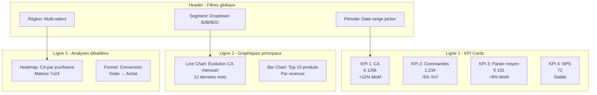

# Business KPI Analysis & Dashboard Design

## Objectif

Analyser les indicateurs clés de performance (KPI) métier, identifier les tendances, détecter les anomalies et concevoir des dashboards décisionnels interactifs pour piloter l'activité business. Transformer les données brutes en métriques actionnables pour la prise de décision stratégique.

---

## Quand l'utiliser (triggers)

- Construction d'un tableau de bord décisionnel pour direction/métier
- Définition et suivi de KPI business (ventes, conversion, rétention, CAC, LTV, churn)
- Analyse de tendances et détection d'anomalies sur métriques métier
- Reporting périodique automatisé (hebdo, mensuel, trimestriel)
- Diagnostic de performance business (où sont les goulots d'étranglement ?)
- Conception de cockpits de pilotage opérationnel temps-réel
- Migration de reporting Excel vers dashboard moderne (Power BI, Tableau, Metabase, Looker)

**Déclencheurs** :
- "Construis un dashboard pour suivre [métrique métier]"
- "Quels KPI suivre pour [objectif business] ?"
- "Pourquoi notre [métrique] baisse depuis [période] ?"
- "Automatise le reporting mensuel de [département]"
- "Détecte les anomalies sur nos ventes"

---

## Hors périmètre

- ❌ **Analyse exploratoire ML/IA** (feature engineering, courbes d'apprentissage, SHAP) → l'agent data science
- ❌ **A/B testing statistique de modèles ML** → l'agent data science + l'agent de machine learning
- ❌ **Audit éthique/fairness des données** → l'agent d'éthique des données
- ❌ **Optimisation requêtes SQL/index base** → l'agent bases de données
- ❌ **Architecture data warehouse/lake** → l'agent bases de données + l'agent d'architecture logicielle
- ❌ **Gouvernance données/qualité master data** → l'agent bases de données (skill Data Governance & Quality)

**Frontière l'agent data science** : 
- l'agent d'analyse de données (ce skill) : KPI métier, dashboards business, SQL analytics, reporting décisionnel
- l'agent data science : EDA pour ML, statistiques ML (feature importance, SHAP), A/B test modèles

---

## Inputs requis

### Informations métier
- **Objectif business** : Quel problème métier résoudre ? (augmenter ventes, réduire churn, optimiser conversion)
- **Public cible** : Qui utilisera le dashboard ? (direction, ops, marketing, finance)
- **Fréquence de rafraîchissement** : Temps-réel, quotidien, hebdo, mensuel ?

### Données disponibles
- **Sources de données** : BDD transactionnelles, CRM, ERP, fichiers CSV/Excel, API, logs
- **Format et volume** : Tables SQL, fichiers plats, API REST, Big Data (>1M lignes)
- **Période historique** : 3 mois, 1 an, 5 ans ?

### Contraintes techniques
- **Outils de visualisation** : Power BI, Tableau, Metabase, Looker, Streamlit, Plotly Dash, Excel avancé
- **Accès données** : Direct SQL, export fichiers, API read-only
- **Budget** : Outils gratuits/open-source ou licences payantes autorisées

---

## Sorties attendues

### Livrables standards
1. **Catalogue KPI définis** : Liste des métriques avec formule, source, fréquence, seuils d'alerte
2. **Maquette dashboard** : Wireframe/mockup de l'organisation visuelle (zones, graphiques, filtres)
3. **Requêtes SQL/scripts** : Code SQL analytique documenté pour calculer chaque KPI
4. **Dashboard interactif** : Fichier .pbix (Power BI), .twb (Tableau), notebook Streamlit ou code HTML/JS
5. **Guide utilisateur** : Documentation d'utilisation du dashboard (filtres, interprétation, actions)

### KPI dashboard typique (exemple e-commerce)
- **Acquisition** : Trafic, sources, coût par visite (CPV), taux de rebond
- **Conversion** : Taux de conversion global/par étape funnel, panier moyen, abandon panier
- **Rétention** : Taux de rétention J+7/J+30, repeat rate, fréquence d'achat
- **Revenus** : CA, marge brute, LTV client, CAC, ratio LTV/CAC
- **Satisfaction** : NPS, CSAT, taux de retour produit, tickets support

---

## Workflow recommandé

### Phase 1 : Discovery métier (2-4h)
1. **Atelier métier** : Interviewer les stakeholders (quels sont les 3-5 décisions clés à piloter ?)
2. **Cartographie des données** : Identifier les sources de données disponibles et leur fiabilité
3. **Benchmark concurrentiel** : Analyser les dashboards existants dans l'industrie (inspiration best practices)

### Phase 2 : Définition KPI (1-2h)
1. **Sélection KPI prioritaires** : Méthode OKR ou North Star Metric (max 5-7 KPI principaux)
2. **Spécification formelle** : Pour chaque KPI, documenter :
   - Formule de calcul exacte
   - Source de données (table, champ)
   - Fréquence de rafraîchissement
   - Seuils d'alerte (rouge/orange/vert)
   - Propriétaire métier du KPI
3. **Validation métier** : Faire valider les définitions avec les stakeholders

### Phase 3 : Préparation des données (2-6h)
1. **Requêtes SQL analytiques** : Écrire les requêtes pour chaque KPI avec :
   - Agrégations (SUM, AVG, COUNT, percentiles)
   - Fenêtrage temporel (rolling average, YoY, MoM)
   - Filtres métier (statut commande, segment client)
   - Optimisation (index suggérés si requêtes >5s)
2. **Data quality checks** : Vérifier cohérence (totaux, NULL, outliers)
3. **Jeux de données de test** : Préparer sample data pour prototypage dashboard

### Phase 4 : Conception dashboard (3-5h)
1. **Wireframe low-fi** : Esquisse papier/Figma de l'organisation visuelle
2. **Choix des visualisations** : Sélectionner le bon type de graphique par KPI :
   - **Évolution temporelle** : Line chart (tendances), area chart (volume cumulé)
   - **Comparaisons** : Bar chart (catégories), bullet chart (objectifs)
   - **Distribution** : Histogram (fréquence), box plot (quartiles)
   - **Proportions** : Pie chart (parts <6 catégories), treemap (hiérarchie)
   - **Corrélation** : Scatter plot (2 variables), heatmap (matrice)
   - **Géographie** : Carte choroplèthe (régions), carte points (localisation)
3. **Design visuel** : Appliquer la charte graphique de l'entreprise (couleurs, logo, polices)
4. **Interactivité** : Définir les filtres (période, segment, région) et drill-down

### Phase 5 : Implémentation (4-8h)
1. **Connexion aux sources** : Configurer les connexions SQL/API dans l'outil de visualisation
2. **Construction des visualisations** : Créer chaque graphique avec les bonnes agrégations
3. **Ajout de filtres** : Implémenter les slicers/filtres interactifs
4. **Calculs dynamiques** : Formules DAX (Power BI) ou LOD (Tableau) si nécessaire
5. **Tests de performance** : Vérifier temps de chargement (<5s pour dashboard interactif)

### Phase 6 : Livraison et formation (2-3h)
1. **Guide utilisateur** : Rédiger la documentation (filtres, interprétation, actions)
2. **Session de formation** : Former les utilisateurs finaux (1h atelier pratique)
3. **Planification maintenance** : Définir responsable mise à jour, fréquence de revue des KPI

---

## Garde-fous

### GF1 - Alignement métier obligatoire
**Règle** : Aucun KPI ne doit être défini sans validation explicite d'un stakeholder métier.

**Justification** : Un dashboard techniquement parfait mais répondant à la mauvaise question business n'a aucune valeur.

**Mesure** : Compte-rendu d'atelier métier documenté avec signatures/approbations.

**Preuve** : Pour chaque KPI du dashboard, tracer le stakeholder valideur et la date de validation.

### GF2 - Règle des 7±2 KPI max par vue
**Règle** : Limiter à 5-9 KPI principaux par dashboard (charge cognitive humaine).

**Justification** : Au-delà de 9 métriques, le cerveau humain ne peut plus prioriser efficacement.

**Mesure** : Compter le nombre de KPI affichés en vue principale.

**Preuve** : Si >9 KPI nécessaires, créer des vues multiples avec navigation (onglets, drill-down).

### GF3 - Performance dashboard (<5s chargement)
**Règle** : Le temps de chargement initial du dashboard doit être <5 secondes sur connexion standard.

**Justification** : Au-delà de 5s, taux d'abandon >40% (source : Google PageSpeed Insights).

**Mesure** : Chronomètre temps de chargement sur connexion réseau standard (50 Mbps).

**Preuve** : Capture d'écran du temps de chargement ou logs de performance de l'outil BI.

**Actions si >5s** :
- Agréger les données en tables précalculées (data mart)
- Limiter la profondeur historique en vue principale
- Implémenter du caching côté serveur
- Optimiser les requêtes SQL (index, partitionnement)

### GF4 - Contexte obligatoire sur chaque métrique
**Règle** : Chaque KPI affiché doit avoir au minimum :
- Définition explicite (tooltip ou légende)
- Période de comparaison (MoM, YoY, vs objectif)
- Seuil d'alerte visuel (rouge/orange/vert)

**Justification** : Un chiffre sans contexte est inutilisable pour la décision.

**Mesure** : Audit du dashboard final (checklist 3 éléments par KPI).

**Preuve** : Capture d'écran de chaque KPI avec tooltip/légende visible.

### GF5 - Data quality disclaimer
**Règle** : Si la qualité des données sources est <95% (NULL, incohérences), afficher un avertissement visible.

**Justification** : Décider sur des données corrompues est pire que ne pas décider.

**Mesure** : Calculer % de complétude et cohérence sur données sources.

**Preuve** : Bandeau d'avertissement affiché en haut du dashboard si qualité <95%.

---

## Template d'entrée (copier/coller)
```text
[Contexte décisionnel]
- Objectif métier, audience et décisions à soutenir : ...
- Sources, période disponible, définition des champs : ...
- Fréquence de rafraîchissement et outils autorisés : ...
- KPI existants, seuils et limites de qualité : ...
```

## Template de sortie (copier/coller)
```text
[Analyse et dashboard]
- KPI retenus avec définition, formule et source : ...
- Tendances constatées, période et limites : ...
- Maquette/visualisations et filtres : ...
- Recommandations, contrôles qualité et prochaines décisions : ...
```

## Templates copier/coller

### Template 1 : Catalogue KPI (Markdown)

```markdown
# Catalogue KPI - [Nom du Dashboard]

**Date de création** : YYYY-MM-DD  
**Propriétaire** : [Nom Stakeholder Métier]  
**Fréquence de mise à jour** : [Quotidien/Hebdo/Mensuel]

---

## KPI 1 : [Nom du KPI]

**Définition** : [Description métier en 1 phrase]

**Formule** :
```sql
SELECT 
    [agrégation] AS kpi_value,
    [dimension] AS dimension
FROM [source_table]
WHERE [filtres_métier]
GROUP BY [dimension]
```

**Source de données** : [Nom table/API]  
**Fréquence de rafraîchissement** : [Temps-réel/J+1/Hebdo]  
**Seuils d'alerte** :
- 🟢 Vert : > [seuil_haut]
- 🟠 Orange : [seuil_bas] - [seuil_haut]
- 🔴 Rouge : < [seuil_bas]

**Propriétaire métier** : [Nom]  
**Date de validation** : YYYY-MM-DD

---

## KPI 2 : ...

[Répéter la structure pour chaque KPI]
```

### Template 2 : Requête SQL analytique (PostgreSQL)

```sql
-- KPI: [Nom du KPI]
-- Description: [Définition métier]
-- Auteur: l'agent d'analyse de données
-- Date: YYYY-MM-DD

WITH base_data AS (
    -- Extraction des données brutes avec filtres métier
    SELECT 
        date_trunc('day', order_date) AS day,
        customer_id,
        order_id,
        revenue,
        status
    FROM orders
    WHERE status IN ('completed', 'shipped')
      AND order_date >= CURRENT_DATE - INTERVAL '90 days'
),

daily_aggregates AS (
    -- Agrégation quotidienne
    SELECT 
        day,
        COUNT(DISTINCT customer_id) AS unique_customers,
        COUNT(order_id) AS total_orders,
        SUM(revenue) AS total_revenue,
        AVG(revenue) AS avg_order_value
    FROM base_data
    GROUP BY day
),

rolling_metrics AS (
    -- Calcul de moyennes mobiles (7 jours)
    SELECT 
        day,
        unique_customers,
        total_orders,
        total_revenue,
        avg_order_value,
        AVG(total_revenue) OVER (
            ORDER BY day 
            ROWS BETWEEN 6 PRECEDING AND CURRENT ROW
        ) AS revenue_ma7
    FROM daily_aggregates
)

-- Résultat final avec comparaison période précédente
SELECT 
    rm.day,
    rm.total_revenue,
    rm.revenue_ma7,
    rm.total_orders,
    rm.avg_order_value,
    -- Comparaison MoM (Month-over-Month)
    LAG(rm.total_revenue, 30) OVER (ORDER BY rm.day) AS revenue_mom,
    -- Variation en %
    ROUND(
        ((rm.total_revenue - LAG(rm.total_revenue, 30) OVER (ORDER BY rm.day)) 
         / NULLIF(LAG(rm.total_revenue, 30) OVER (ORDER BY rm.day), 0)) * 100, 
        2
    ) AS revenue_change_pct
FROM rolling_metrics rm
ORDER BY rm.day DESC
LIMIT 90;
```

### Template 3 : Wireframe dashboard (Mermaid)



---

## Checklist QA interne

**Avant livraison dashboard, valider** :

### Qualité des données
- [ ] Toutes les sources de données sont accessibles et à jour
- [ ] Les NULL/valeurs manquantes sont traitées (exclusion ou imputation documentée)
- [ ] Les doublons sont détectés et éliminés
- [ ] Les outliers statistiques sont identifiés et justifiés (ou corrigés)
- [ ] La cohérence inter-tables est vérifiée (foreign keys, totaux)

### Définition des KPI
- [ ] Chaque KPI a une formule de calcul explicite et validée métier
- [ ] Les seuils d'alerte (rouge/orange/vert) sont définis et justifiés
- [ ] Les périodes de comparaison (MoM, YoY, vs objectif) sont documentées
- [ ] Le propriétaire métier de chaque KPI est identifié

### Expérience utilisateur
- [ ] Le dashboard se charge en <5 secondes sur connexion standard
- [ ] Les filtres sont intuitifs et réactifs (<2s après sélection)
- [ ] Les graphiques sont lisibles (polices ≥10pt, contrastes WCAG AA)
- [ ] La navigation entre vues est fluide (drill-down/up cohérents)
- [ ] Le dashboard est responsive (fonctionne sur tablette)

### Documentation
- [ ] Un guide utilisateur est fourni (PDF ou vidéo <5min)
- [ ] Les requêtes SQL sont documentées et versionnées (Git)
- [ ] Un calendrier de maintenance est défini (qui, quand, comment)
- [ ] Les contacts support sont clairement affichés

### Sécurité et conformité
- [ ] Les accès au dashboard sont restreints selon rôles (RBAC)
- [ ] Les données personnelles sont masquées si nécessaire (RGPD)
- [ ] Les exports de données sont tracés (logs d'audit)

---

## KPI de la skill

| KPI | Formule | Cible | Fréquence mesure |
|-----|---------|-------|------------------|
| Taux d'adoption dashboard | (Utilisateurs actifs mensuels / Utilisateurs invités) x 100 | ≥ 70% | Mensuel |
| Temps de chargement dashboard | Médiane du temps de chargement initial | < 5s | Hebdo |
| Taux de qualité données | (Lignes valides / Lignes totales) x 100 | ≥ 95% | Quotidien |
| NPS utilisateurs dashboard | Score NPS post-formation | ≥ 50 | Trimestriel |
| Nombre de décisions prises | Décisions business documentées basées sur dashboard | ≥ 3/mois | Mensuel |

---

## Definition of done

Un dashboard est considéré **terminé** si :

1. ✅ **Validation métier** : Les 3-5 KPI principaux sont validés par les stakeholders métier
2. ✅ **Performance** : Temps de chargement <5s mesuré sur connexion standard
3. ✅ **Qualité données** : Taux de complétude ≥95% sur toutes les sources
4. ✅ **Documentation** : Guide utilisateur rédigé et validé par 2 utilisateurs test
5. ✅ **Formation** : Au moins 1 session de formation réalisée avec utilisateurs finaux
6. ✅ **Accessibilité** : Dashboard accessible selon RBAC défini, logs d'audit actifs
7. ✅ **Maintenance planifiée** : Responsable et calendrier de mise à jour définis

---

## Exemples

### Exemple 1 : Dashboard ventes e-commerce

**Contexte** : Site e-commerce B2C, 10k commandes/mois, stack Shopify + PostgreSQL

**KPI suivis** :
- CA quotidien + MA7 (moyenne mobile 7 jours)
- Taux de conversion global (visiteurs → acheteurs)
- Panier moyen
- Top 10 produits par revenue
- Taux d'abandon panier
- NPS client

**Outils** : Power BI connecté en direct-query sur PostgreSQL

**Livraison** : 
- Dashboard interactif avec filtres (date, catégorie produit, source trafic)
- Rafraîchissement automatique chaque nuit à 1h
- Formation de 5 utilisateurs métier (direction, marketing, ops)
- Temps de chargement : 3,2s

### Exemple 2 : KPI RH (suivi turnover)

**Contexte** : Entreprise 500 employés, besoin de piloter rétention talents

**KPI suivis** :
- Taux de turnover mensuel (départs / effectif moyen)
- Taux de turnover volontaire vs involontaire
- Durée moyenne dans l'entreprise par département
- Coût moyen de recrutement par profil
- Temps de pourvu des postes ouverts
- eNPS (employee Net Promoter Score)

**Outils** : Google Looker Studio connecté sur Google Sheets (export SIRH)

**Livraison** :
- Dashboard temps-réel accessible direction et RH
- Alerte email si turnover >15% sur un département
- Comparaison inter-départements et benchmark secteur
- Guide d'interprétation (quelle action si métrique rouge ?)

### Exemple 3 : Cockpit opérationnel call center

**Contexte** : Centre d'appels 50 agents, besoin de pilotage temps-réel

**KPI suivis** :
- Nombre d'appels en attente (live)
- Temps d'attente moyen (SLA <2min)
- Taux de résolution au 1er contact (FCR)
- Taux d'occupation agents
- Satisfaction client post-appel (CSAT)
- Nombre d'escalades vers N2

**Outils** : Dashboard Streamlit (Python) + refresh toutes les 30 secondes

**Livraison** :
- Affichage mural sur TV 55" dans le call center
- Alertes sonores si SLA dépassé (temps attente >2min)
- Drill-down par agent pour coaching individuel
- Historique 30 jours pour analyse tendances

---

## Contraintes

- **Respect RGPD** : Aucune donnée personnelle identifiable (nom, email, téléphone) ne doit être affichée sans anonymisation ou autorisation explicite
- **Accès sécurisé** : Le dashboard doit implémenter un contrôle d'accès basé sur les rôles (RBAC)
- **Versioning des requêtes** : Toutes les requêtes SQL doivent être versionnées dans Git avec commentaires de changements
- **Budget outils BI** : Privilégier les solutions open-source (Metabase, Superset, Streamlit) si budget <5k€/an ; licences commerciales (Power BI, Tableau) si >5k€/an justifié

---

**Date de création** : 2026-08-04  
**Dernière mise à jour** : 2026-08-04  
**Agents propriétaires** : l'agent d'analyse de données

## Exemples d'usage

### Exemple 1 : Diagnostiquer une baisse de conversion en ligne
**Contexte** : L'équipe commerciale constate une baisse du taux de conversion et veut localiser l'étape du parcours concernée.  
**Input** : Définitions existantes du funnel, données de sessions et commandes, période de comparaison, segments métier et source de vérité des événements.  
**Output** : KPI avec formule et limites, comparaison par étape/segment, hypothèses à vérifier et maquette de tableau de bord orientée décisions.

### Exemple 2 : Automatiser le reporting mensuel des abonnements
**Contexte** : Le rapport manuel de rétention prend plusieurs jours et les chiffres varient selon les équipes.  
**Input** : Tables d'abonnement et de facturation, définition métier du churn, calendrier de clôture, audience et fréquence de rafraîchissement.  
**Output** : Dictionnaire des KPI, règles de calcul documentées, maquette de suivi mensuel et contrôles de cohérence à valider avec les owners de données.
