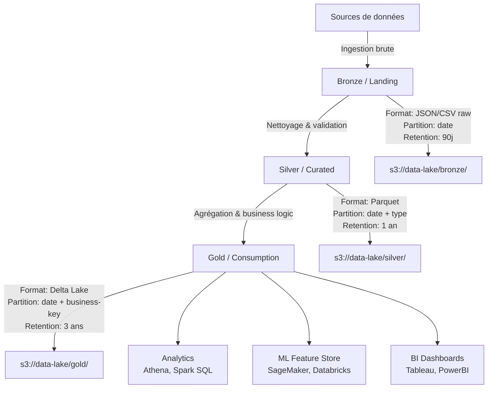

# Data Lake Architecture & Storage

## Objectif
Concevoir, implémenter et optimiser des architectures de data lake modernes (on-prem ou cloud) avec stratégies de partitionnement, formats de stockage optimaux et gouvernance des couches de données (bronze/silver/gold ou landing/curated/consumption).

## Quand l'utiliser (triggers)
- Conception d'une architecture data lake from scratch (cloud ou on-prem)
- Migration d'un data warehouse traditionnel vers data lake moderne
- Optimisation de la structure de stockage (formats, partitionnement, compression)
- Mise en place d'une architecture multi-couches (bronze/silver/gold, medallion architecture)
- Choix de formats de données (Parquet, Avro, ORC, Delta Lake, Iceberg, Hudi)
- Stratégie de rétention et archivage de données à long terme
- Intégration data lake + data warehouse (architecture lakehouse)

## Hors périmètre
- ❌ Pipelines ETL/ELT concrets → etlPipelineDesignOrchestration.skill.md
- ❌ Infrastructure cloud (VPC, IAM, réseau) → l'agent d'architecture cloud
- ❌ Requêtes analytiques et optimisation SQL → l'agent bases de données
- ❌ Gouvernance données (catalogues, lineage) → dataCatalogLineage.skill.md
- ❌ Streaming temps réel → streamingDataProcessing.skill.md

## Inputs requis
- **Volumétrie attendue** : GB/TB/PB, croissance projetée sur 3-5 ans
- **Types de données** : structurées, semi-structurées (JSON/XML), non-structurées (logs, images)
- **Patterns d'accès** : batch analytics, requêtes ad-hoc, ML feature store, streaming
- **Contraintes** : budget, latence requêtes, compliance (RGPD, HIPAA), multi-région
- **Stack cible** : AWS (S3+Athena+Glue), Azure (ADLS+Synapse), GCP (GCS+BigQuery), Databricks, Snowflake, ou on-prem (HDFS, MinIO)

## Sorties attendues
- **Architecture design document** : diagramme C4 ou architecture AWS/Azure, description couches (bronze/silver/gold)
- **Stratégie de partitionnement** : par date (YYYY/MM/DD), par région, par type, évolutive
- **Choix de formats** : justification technique (Parquet vs Delta vs Iceberg), compression (Snappy, ZSTD)
- **Modèle de gouvernance** : ownership zones (landing/raw/curated), droits d'accès (IAM/RBAC)
- **Estimation coûts** : stockage, compute queries, data transfer, sur 1-3 ans
- **Plan de migration** : si migration depuis legacy (phases, risques, rollback)

## Workflow recommandé
1. **Analyse des besoins** :
   - Identifier les sources de données (volumétrie, format, fréquence)
   - Cartographier les use cases (analytics, ML, reporting, archivage)
   - Définir les SLA (latence requêtes, fraîcheur données)

2. **Design de l'architecture** :
   - Choisir la topologie (3 couches bronze/silver/gold, zone-based, ou lakehouse)
   - Définir le partitionnement (date, région, type, multi-level)
   - Sélectionner les formats de stockage par couche et par use case

3. **Stratégie de stockage** :
   - Définir la politique de rétention (hot/warm/cold/archive)
   - Configurer la réplication et la sauvegarde (RPO/RTO)
   - Optimiser la compression et le compactage (small files problem)

4. **Gouvernance et sécurité** :
   - Définir les zones d'accès (data mesh vs centralized)
   - Configurer le contrôle d'accès (IAM policies, RBAC, ACLs)
   - Mettre en place l'audit et le logging (CloudTrail, audit logs)

5. **Validation et optimisation** :
   - Tester les performances requêtes (scan rate, query time)
   - Mesurer les coûts réels vs budget
   - Ajuster le partitionnement/format selon patterns d'accès observés

## Garde-fous
- **GF1 - Partitionnement par date obligatoire** : Toute table volumineuse (>1TB) doit être partitionnée par date (YYYY/MM/DD ou YYYY/MM). Interdire les tables non partitionnées. Mesure : 0% des tables >1TB sans partition date.
- **GF2 - Formats ouverts uniquement** : Interdire formats propriétaires (Excel, Access). Autoriser : Parquet, Avro, ORC, JSON, CSV. Mesure : 100% des données en formats ouverts.
- **GF3 - Bronze = immutable** : Couche bronze (raw) doit être en append-only, jamais de DELETE/UPDATE. Mesure : 0 DELETE/UPDATE sur buckets bronze en audit logs.
- **GF4 - Small files < 1%** : Éviter la fragmentation (milliers de petits fichiers). Compacter régulièrement. Mesure : < 1% des fichiers < 100MB dans silver/gold.
- **GF5 - Compression obligatoire** : Activer compression (Snappy, ZSTD, Gzip) sur toutes les couches. Mesure : 100% des nouveaux fichiers compressés.
- **GF6 - Lifecycle policies** : Configurer transition auto vers tiers froid/archive après N jours. Mesure : 100% des buckets avec lifecycle policy définie.
- **GF7 - Coûts storage < budget** : Monitorer le coût de stockage mensuel et alerter si dépassement. Mesure : coût storage ≤ budget mensuel (±10%).

## Template d'entrée (copier/coller)
```text
[Contexte lake/lakehouse]
- Sources, formats et volumes actuels/prévus : ...
- Usages analytiques, latence et consommateurs : ...
- Cloud/on-prem, technologies imposées et budget : ...
- Sécurité, résidence, rétention et gouvernance : ...
```

## Template de sortie (copier/coller)
```text
[Architecture de stockage]
- Zones/couches et formats retenus : ...
- Partitionnement, catalogage et accès : ...
- Cycle de vie, rétention et coûts estimés : ...
- Qualité, sécurité, risques et critères de validation : ...
```

## Templates copier/coller

### Template architecture 3 couches (Mermaid)


### Template partitionnement multi-niveaux (Hive-style)
```
s3://data-lake/silver/events/
├── year=2024/
│   ├── month=01/
│   │   ├── day=01/
│   │   │   ├── part-00000.parquet (100MB, Snappy)
│   │   │   ├── part-00001.parquet (100MB, Snappy)
│   │   │   └── ...
│   │   ├── day=02/
│   │   └── ...
│   ├── month=02/
│   └── ...
└── year=2025/

Avantages :
- Pruning efficace : requêtes filtrent par year/month/day
- Backfill facile : remplacer partition date complète
- Compaction : regrouper small files par partition

Règles :
- Taille fichier optimale : 100-200MB (ni trop petit, ni trop gros)
- Compression : Snappy (bon compromis vitesse/taux)
- Naming : part-XXXXX.parquet (standard Spark/Hive)
```

### Template config AWS S3 lifecycle (JSON)
```json
{
  "Rules": [
    {
      "Id": "TransitionToIA",
      "Status": "Enabled",
      "Prefix": "bronze/",
      "Transitions": [
        {
          "Days": 30,
          "StorageClass": "STANDARD_IA"
        },
        {
          "Days": 90,
          "StorageClass": "GLACIER"
        }
      ],
      "Expiration": {
        "Days": 365
      }
    },
    {
      "Id": "KeepSilverLonger",
      "Status": "Enabled",
      "Prefix": "silver/",
      "Transitions": [
        {
          "Days": 90,
          "StorageClass": "INTELLIGENT_TIERING"
        }
      ]
    },
    {
      "Id": "GoldLongTerm",
      "Status": "Enabled",
      "Prefix": "gold/",
      "Transitions": [
        {
          "Days": 180,
          "StorageClass": "GLACIER_IR"
        }
      ]
    }
  ]
}
```

### Template Delta Lake table creation (Scala/Python)
```python
from delta.tables import DeltaTable
from pyspark.sql import SparkSession

spark = SparkSession.builder \
    .config("spark.sql.extensions", "io.delta.sql.DeltaSparkSessionExtension") \
    .config("spark.sql.catalog.spark_catalog", "org.apache.spark.sql.delta.catalog.DeltaCatalog") \
    .getOrCreate()

# Create Delta Lake table with partitioning and optimize
df = spark.read.parquet("s3://data-lake/silver/events/")

(df.write
    .format("delta")
    .mode("overwrite")
    .partitionBy("year", "month", "day")
    .option("overwriteSchema", "true")
    .save("s3://data-lake/gold/events-delta/")
)

# Optimize: compact small files
deltaTable = DeltaTable.forPath(spark, "s3://data-lake/gold/events-delta/")
deltaTable.optimize().executeCompaction()

# Vacuum: delete old versions (retain 7 days)
deltaTable.vacuum(retentionHours=7*24)

# Z-ordering: cluster data by frequently filtered columns
deltaTable.optimize().executeZOrderBy("user_id", "event_type")
```

### Template Apache Iceberg table creation (SQL)
```sql
-- Create Iceberg table with partitioning evolution support
CREATE TABLE catalog.db.events (
    event_id STRING,
    user_id STRING,
    event_type STRING,
    event_timestamp TIMESTAMP,
    properties MAP<STRING, STRING>,
    year INT,
    month INT,
    day INT
)
USING iceberg
PARTITIONED BY (year, month, day)
LOCATION 's3://data-lake/gold/events-iceberg/'
TBLPROPERTIES (
    'write.format.default' = 'parquet',
    'write.parquet.compression-codec' = 'zstd',
    'commit.retry.num-retries' = '5'
);

-- Add partition evolution (change partitioning without rewrite)
ALTER TABLE catalog.db.events
SET PARTITION SPEC (year, month);  -- Remove day partition

-- Compact small files (Iceberg maintenance)
CALL catalog.system.rewrite_data_files(
    table => 'catalog.db.events',
    options => map('target-file-size-bytes', '134217728')  -- 128MB
);

-- Expire old snapshots (retention)
CALL catalog.system.expire_snapshots(
    table => 'catalog.db.events',
    older_than => TIMESTAMP '2024-01-01 00:00:00',
    retain_last => 5
);
```

## Checklist QA interne
- [ ] L'architecture définit-elle 3 couches claires (bronze/silver/gold) avec responsabilités ?
- [ ] Le partitionnement est-il défini par date pour toutes les tables >1TB ?
- [ ] Les formats de données sont-ils ouverts et optimisés (Parquet, Delta, Iceberg) ?
- [ ] La compression est-elle activée sur toutes les couches ?
- [ ] Une stratégie de lifecycle est-elle configurée (transition vers tiers froids) ?
- [ ] La couche bronze est-elle en append-only (immutable) ?
- [ ] Les coûts de stockage sont-ils estimés et monitorés ?
- [ ] Les droits d'accès sont-ils définis par zone (IAM/RBAC) ?
- [ ] Un plan de compaction des small files est-il en place ?
- [ ] La documentation inclut-elle un diagramme d'architecture (C4/Mermaid) ?

## KPI
- **Coût storage par TB/mois** : suivre tendance et optimiser si ↑, benchmark cloud: $20-30/TB/mois
- **Taux compression moyen** : (taille compressée / taille raw) × 100, cible 70-80% (Parquet Snappy)
- **% données en tiers froid** : (cold/archive storage / total storage) × 100, cible >50% si données historiques
- **Latence requête P95** : temps 95e percentile sur requêtes gold, cible <10s
- **% small files** : (fichiers <100MB / total fichiers) × 100, cible <1%
- **Volumétrie quotidienne ingérée** : GB/jour en bronze, suivre croissance vs capacité

## Definition of done
- ✅ Architecture documentée avec diagramme C4/Mermaid et description des 3 couches
- ✅ Partitionnement défini et appliqué sur toutes les tables >100GB
- ✅ Formats optimisés choisis et justifiés (Parquet/Delta/Iceberg)
- ✅ Lifecycle policies configurées (transition auto vers tiers froids)
- ✅ Compression activée (Snappy, ZSTD ou Gzip)
- ✅ Plan de compaction small files documenté et testé
- ✅ Coûts estimés sur 12 mois et validés vs budget
- ✅ Droits d'accès configurés (IAM/RBAC) avec principe du moindre privilège
- ✅ Requête test exécutée avec succès sur chaque couche (bronze, silver, gold)
- ✅ Monitoring mis en place (coûts, volumétrie, latence requêtes)

## Exemples

### Exemple 1 : Data lake e-commerce (AWS S3 + Athena + Glue)
**Contexte** : Startup e-commerce avec 10TB de données (commandes, clics web, logs serveur), croissance 5TB/mois.

**Architecture 3 couches** :
- **Bronze** : S3 `s3://datalake/bronze/` — JSON brut, partition par date, retention 90j, transition GLACIER après 30j
- **Silver** : S3 `s3://datalake/silver/` — Parquet nettoyé, partition date + source, retention 1 an, INTELLIGENT_TIERING après 90j
- **Gold** : S3 `s3://datalake/gold/` — Delta Lake, partition date + business-key, retention 3 ans, GLACIER_IR après 180j

**Formats** :
- Bronze : JSON (raw)
- Silver : Parquet + Snappy (70% compression)
- Gold : Delta Lake (ACID, time-travel, merge upsert)

**Résultat** : Coût storage réduit de 60% (lifecycle + compression), requêtes Athena 5x plus rapides (Parquet vs JSON).

---

### Exemple 2 : Lakehouse architecture (Databricks + Delta Lake)
**Contexte** : Entreprise fintech avec besoins analytics + ML, data warehouse Teradata coûteux à migrer.

**Architecture lakehouse** :
- **Landing zone** : ADLS Gen2 bronze — données brutes inchangées (compliance, audit trail)
- **Curated zone** : Delta Lake silver — nettoyage, validation, schéma appliqué
- **Feature store** : Delta Lake gold — features ML pré-calculées (latency <100ms)

**Partitionnement** :
- Silver : `year/month/day/transaction_type` (multi-level)
- Gold : `year/month` + Z-ordering sur `customer_id` (clustering)

**Résultat** : Migration Teradata → Lakehouse en 6 mois, coût -70%, latence requêtes -50%, ML features disponibles en <100ms.

---

### Exemple 3 : Multi-region data lake (GCP GCS + BigQuery)
**Contexte** : Application SaaS mondiale, réplication multi-région pour conformité RGPD (données EU en EU, US en US).

**Architecture** :
- **EU region** : GCS `gs://datalake-eu/` — données clients EU, BigQuery dataset EU
- **US region** : GCS `gs://datalake-us/` — données clients US, BigQuery dataset US
- **Global** : GCS `gs://datalake-global/` — données agrégées anonymisées

**Formats** :
- BigQuery native (Capacitor columnar) pour gold
- Avro + Snappy pour silver (interop Kafka)
- JSON pour bronze (flexibilité schéma)

**Résultat** : Conformité RGPD (data residency), latence requêtes locale <2s, coûts data transfer optimisés.

## Contraintes
- **Volumétrie max** : Ce skill couvre architectures jusqu'à plusieurs PB. Au-delà, consulter l'agent d'architecture cloud pour architecture distribuée multi-cluster (ex: data mesh).
- **Gouvernance avancée** : Catalogage, lineage, data quality rules → dataCatalogLineage.skill.md.
- **Requêtes analytiques** : Optimisation SQL, indexes, vues matérialisées → l'agent bases de données.
- **Streaming temps réel** : Kappa architecture (stream-first) → streamingDataProcessing.skill.md.

## Exemples d'usage

### Exemple 1 : Moderniser le stockage des journaux analytiques
**Contexte** : Des journaux applicatifs sont conservés en fichiers dispersés et les analyses historiques deviennent coûteuses et lentes.  
**Input** : Formats, volumes quotidiens et croissance, requêtes attendues, exigences de rétention/suppression et contraintes d'hébergement.  
**Output** : Architecture de zones brutes/curées/consommation, partitionnement et format ouverts proposés, règles de cycle de vie et estimation à valider avec l'équipe infrastructure.

### Exemple 2 : Préparer un lakehouse pour les analyses de commandes
**Contexte** : Plusieurs équipes veulent exploiter des données de commandes sans multiplier les extractions incompatibles.  
**Input** : Sources et schémas, fréquence d'actualisation, consommateurs (BI/ML), besoins d'historisation, accès et budget.  
**Output** : Schéma de flux et de couches, choix de tables/fichiers et conventions, politique d'accès/rétention et tests de performance à réaliser sur des données représentatives.
