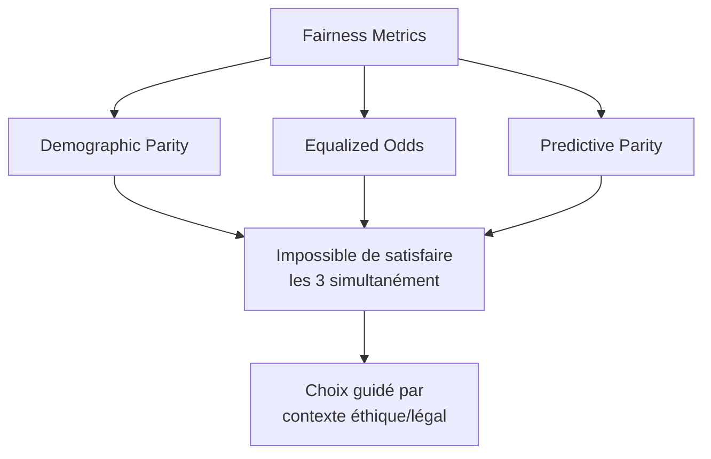

# Fairness & Bias Detection

## Objectif
Détecter, mesurer et réduire les biais algorithmiques des systèmes d'intelligence artificielle au moyen d'analyses de données, de métriques de fairness et de stratégies de mitigation.

## Agents principaux
- L'agent d'éthique des données
- L'agent de machine learning
- L'agent spécialiste en IA générative

## Quand l'utiliser (triggers)
- Auditer des données ou prédictions pour détecter des écarts entre groupes.
- Comparer des métriques de fairness et documenter leurs compromis.
- Évaluer des mitigations de biais avant ou après déploiement.

## Hors périmètre
- Une métrique ou un seuil isolé ne prouve pas l'absence de discrimination ni la conformité juridique.
- La sélection des attributs sensibles et les décisions de déploiement nécessitent validation métier, éthique et juridique.
- La correction de données ou de modèle en production relève des owners responsables.

## Inputs requis
- Cas d'usage, décision, cible, modèle/version et population évaluée.
- Données de test avec attributs de groupes légalement et éthiquement utilisables.
- Définitions d'outcomes, métriques, seuils proposés et coûts des erreurs.
- Contraintes de taille d'échantillon, confidentialité et contexte juridique.

## Sorties attendues
- Profil de représentativité et qualité des données par groupe.
- Métriques de disparité avec incertitudes, dénominateurs et limites.
- Analyse comparative des compromis et recommandations de mitigation.
- Plan de validation après mitigation et suivi en production.

## Workflow recommandé
1. Définir populations, décisions, groupes et résultats pertinents avec les parties responsables.
2. Vérifier représentativité, qualité des labels, effectifs et données manquantes.
3. Sélectionner des métriques en fonction du contexte et expliciter les compromis.
4. Calculer écarts avec intervalles/incertitudes et examiner les causes possibles.
5. Comparer mitigations sans dégrader silencieusement d'autres groupes ou métriques.
6. Valider avec parties prenantes compétentes et définir le monitoring.

## Garde-fous
- Le ratio 0,8 est un repère historique de dépistage dans certains contextes, pas une règle universelle ni une preuve de conformité.
- Vérifier effectifs, intervalles d'incertitude, base rates et qualité des labels avant de comparer.
- Ne pas supprimer un attribut sensible sans vérifier le risque de proxies ou d'aggravation des disparités.
- Documenter les compromis entre définitions de fairness; aucune métrique seule n'est suffisante.
- Respecter les contraintes légales et de confidentialité liées au traitement des attributs sensibles.

## Template d'entrée (copier/coller)
```text
[Cas d'usage/décision/population] ...
[Modèle/version et jeu de test] ...
[Groupes/attributs et autorisation d'usage] ...
[Métriques/seuils proposés et coûts d'erreur] ...
```

## Template de sortie (copier/coller)
```text
[Qualité/représentativité] Effectifs, manquants, limites : ...
[Métriques] Définition, résultats par groupe, incertitudes : ...
[Interprétation] Écarts, compromis et causes à investiguer : ...
[Mitigation/validation] Mesure, owner, tests de non-régression et suivi : ...
```

## Checklist QA interne
- Les groupes et décisions sont-ils définis et justifiés?
- Les effectifs, incertitudes, labels et valeurs manquantes sont-ils vérifiés?
- Les métriques choisies reflètent-elles le contexte, avec leurs compromis?
- Les mitigations sont-elles évaluées par groupe et en non-régression?
- Les limites légales et de confidentialité sont-elles explicites?

## KPI reliés
- Écart de métriques de fairness suivi par groupe et par version du modèle.
- Part des mitigations évaluées avec tests de non-régression multi-groupes.
- Temps de résolution des écarts prioritaires et incidents discriminatoires signalés.

## Definition of done
- Les résultats sont documentés par groupe avec effectifs et incertitudes.
- Métriques, seuils et compromis sont justifiés et non présentés comme universels.
- Les mitigations et le plan de suivi sont attribués et vérifiables.

## Compétences détaillées

### 1. Détection de biais dans les données
**Objectif** : Identifier les biais présents dans les datasets d'entraînement avant la modélisation.

**Techniques** :
- **Analyse distribution démographique** : vérifier représentativité groupes protégés
- **Détection biais historiques** : identifier patterns discriminatoires dans données legacy
- **Analyse corrélations proxies** : détecter features corrélées à attributs sensibles (redlining)
- **Statistical parity testing** : comparer distributions outcomes par groupe

**Métriques clés** :
- **Disparate impact ratio** : P(positive|groupe_A) / P(positive|groupe_B) ≥ 0.8 (règle 80%)
- **Statistical parity difference** : |P(positive|A) - P(positive|B)| ≤ seuil
- **Coefficient de Gini** : mesure inégalité distribution

**Livrables** :
- Rapport d'analyse dataset avec flags biais détectés
- Recommandations data collection éthique
- Stratégies rebalancing/reweighting

**Exemple** :
```markdown
## Analyse Biais Dataset : Credit Scoring

### Distribution démographique
- Genre : 65% H / 35% F (sous-représentation femmes)
- Âge : 80% 25-55 ans / 20% autres (biais âge)
- Origine : données manquantes 30% groupe minoritaire X

### Biais historiques détectés
- Taux approbation crédit historique : 75% groupe A vs 45% groupe B
- Corrélation ZIP code (proxy origine ethnique) → décision (r=0.62)

### Disparate impact ratio
- Genre : 0.73 < 0.8 ❌ (discrimination potentielle)
- Âge : 0.85 ≥ 0.8 ✅

### Recommandations
1. Rebalancer dataset (sursampling groupe B ou undersampling groupe A)
2. Supprimer/anonymiser ZIP code (proxy discrimination)
3. Auditer décisions historiques groupe B pour corriger labels biaisés
```


### 2. Métriques de fairness pour modèles ML
**Objectif** : Mesurer la fairness des prédictions d'un modèle déployé selon différentes définitions mathématiques.

**Métriques principales** :

#### Demographic Parity (Independence)
- **Définition** : P(Ŷ=1|A=0) = P(Ŷ=1|A=1)
- **Quand utiliser** : quand objectif = égalité de résultats (outcomes) entre groupes
- **Exemple** : taux d'admission université identique par genre
- **Limite** : ignore différences mérite réel (peut pénaliser groupes performants)

#### Equalized Odds (Separation)
- **Définition** : P(Ŷ=1|Y=y,A=a) indépendant de A pour y ∈ {0,1}
- **Quand utiliser** : quand objectif = égalité de traitement à mérite égal
- **Exemple** : taux faux positifs/négatifs identique par groupe
- **Limite** : peut accepter disparités si corrélées à mérite réel

#### Predictive Parity (Sufficiency)
- **Définition** : P(Y=1|Ŷ=1,A=a) indépendant de A
- **Quand utiliser** : quand prédictions doivent être également fiables par groupe
- **Exemple** : précision score de crédit identique par origine
- **Limite** : peut masquer biais si base rates différentes

**Trade-offs** :


**Livrables** :
- Tableau comparatif métriques par groupe démographique
- Visualisations disparités (bar charts, confusion matrices par groupe)
- Recommandation métrique prioritaire selon contexte

**Exemple** :
```markdown
## Métriques Fairness : Système Recrutement IA

| Métrique | Groupe A | Groupe B | Écart | Seuil | Status |
|----------|----------|----------|-------|-------|--------|
| Demographic Parity | 0.42 | 0.31 | 0.11 | ≤0.05 | ❌ |
| Equalized Odds (TPR) | 0.85 | 0.78 | 0.07 | ≤0.10 | ✅ |
| Equalized Odds (FPR) | 0.12 | 0.18 | 0.06 | ≤0.10 | ✅ |
| Predictive Parity (PPV) | 0.88 | 0.82 | 0.06 | ≤0.10 | ✅ |

### Analyse
- **Demographic Parity violée** : groupe B reçoit 26% moins d'offres d'emploi
- **Equalized Odds respectée** : à qualifications égales, taux sélection similaire
- **Interprétation** : disparité reflète différence qualifications réelles (acceptable) OU biais modèle/données (à investiguer)

### Recommandation
Investiguer : le pipeline d'acquisition candidats (job ads, plateformes) défavorise-t-il groupe B ? Si oui, mitigation en amont (diversification sourcing).
```


### 3. Stratégies de mitigation des biais
**Objectif** : Implémenter des techniques pour réduire/éliminer biais détectés selon phase du pipeline ML.

#### Pre-processing (données)
- **Reweighting** : assigner poids inversement proportionnels à représentation groupe
- **Resampling** : sursampler groupe minoritaire ou undersampler groupe majoritaire
- **Disparate Impact Remover** : transformer features pour réduire corrélation avec attribut sensible
- **Fairness-aware feature engineering** : créer features débiaisées

**Exemple** :
```python
from aif360.algorithms.preprocessing import Reweighing
from aif360.datasets import BinaryLabelDataset

# Reweighting pour équilibrer outcomes par groupe
rw = Reweighing(unprivileged_groups=[{'gender': 0}],
                privileged_groups=[{'gender': 1}])
dataset_transformed = rw.fit_transform(dataset)
```

#### In-processing (entraînement)
- **Adversarial debiasing** : entraîner modèle adversarial pour prédire label sans pouvoir prédire attribut sensible
- **Fairness constraints** : ajouter contraintes de fairness comme régularisation
- **Prejudice remover** : régularisation pénalisant dépendance prédictions ↔ attribut sensible

**Exemple** :
```python
from aif360.algorithms.inprocessing import AdversarialDebiasing
import tensorflow as tf

# Adversarial debiasing
sess = tf.Session()
debiased_model = AdversarialDebiasing(
    privileged_groups=[{'gender': 1}],
    unprivileged_groups=[{'gender': 0}],
    scope_name='debiased_classifier',
    debias=True,
    sess=sess
)
debiased_model.fit(dataset_train)
```

#### Post-processing (prédictions)
- **Threshold optimization** : ajuster seuils de décision par groupe pour respecter fairness
- **Reject option classification** : rejeter prédictions incertaines proches frontière décision
- **Calibrated equalized odds** : post-traiter scores pour satisfaire equalized odds

**Exemple** :
```python
from aif360.algorithms.postprocessing import CalibratedEqOddsPostprocessing

# Calibrated Equalized Odds
cpp = CalibratedEqOddsPostprocessing(
    privileged_groups=[{'gender': 1}],
    unprivileged_groups=[{'gender': 0}],
    cost_constraint='fpr',  # minimiser écart FPR
    seed=42
)
dataset_pred_fair = cpp.fit_predict(dataset_valid, dataset_pred)
```

**Livrables** :
- Code de mitigation implémenté et testé
- Analyse impact mitigation sur performance (accuracy/fairness trade-off)
- Recommandation stratégie optimale selon contexte


### 4. Audit fairness en production
**Objectif** : Monitorer fairness en continu post-déploiement et détecter dérives discriminatoires.

**Processus** :
1. **Collecte données prédictions** : logger décisions + attributs sensibles (avec consentement RGPD)
2. **Calcul métriques périodique** : mensuel/trimestriel selon criticité
3. **Détection drift fairness** : comparer métriques actuelles vs baseline
4. **Alertes automatiques** : déclencher si seuil critique dépassé
5. **Root cause analysis** : investiguer cause dérive (data drift, model drift, concept drift)
6. **Réentraînement si nécessaire** : avec nouvelles données débiaisées

**Métriques monitoring** :
- Évolution temporal métriques fairness (tendances)
- Distribution prédictions par groupe (histogrammes)
- Taux d'erreur par segment démographique

**Livrables** :
- Dashboard monitoring fairness temps réel
- Rapport mensuel audit fairness
- Procédure escalade si drift détecté


### 5. Communication et documentation fairness
**Objectif** : Documenter analyse fairness de manière compréhensible pour stakeholders non-techniques.

**Artefacts** :
- **Model Card** (section Fairness) : métriques, groupes testés, limitations connues
- **Datasheet for Datasets** : composition démographique, biais potentiels
- **Fairness Assessment Report** : audit complet avec recommandations

**Template Model Card (section Fairness)** :
```markdown
## Fairness, Bias, and Limitations

### Groupes évalués
- Genre (Homme/Femme/Non-binaire)
- Âge (18-25 / 26-40 / 41-60 / 60+)
- Origine (données auto-déclarées)

### Métriques fairness
| Métrique | Homme | Femme | Écart | Status |
|----------|-------|-------|-------|--------|
| Demographic Parity | 0.42 | 0.38 | 0.04 | ✅ |
| Equalized Odds (TPR) | 0.85 | 0.83 | 0.02 | ✅ |

### Limitations connues
- Sous-représentation groupe âge 60+ dans données d'entraînement (5%)
- Données origine manquantes pour 20% échantillon
- Métriques non testées sur population non-binaire (N < 50)

### Recommandations d'usage
- Supervision humaine obligatoire pour décisions impactant groupe 60+
- Revalidation annuelle fairness sur nouvelles cohortes
```

**Livrables** :
- Model card complétée
- Présentation exécutive (slides vulgarisées)
- FAQ fairness pour utilisateurs finaux


## Anti-patterns à éviter
- ❌ Optimiser uniquement demographic parity sans considérer equalized odds (peut masquer biais réel)
- ❌ Supprimer attribut sensible du dataset sans vérifier proxies (age, ZIP code peuvent encoder race/genre)
- ❌ Appliquer mitigation biais sans mesurer impact sur performance globale
- ❌ Auditer fairness uniquement pré-déploiement (biais peuvent émerger en production)
- ❌ Utiliser métriques fairness inadaptées au contexte (ex: demographic parity pour diagnostic médical)
- ❌ Ignorer intersectionnalité (femme + minorité = biais cumulés non détectés par analyses séparées)


## Cas d'usage typiques

### Recrutement automatisé
- **Risque** : biais genre/origine dans sélection CV
- **Métrique prioritaire** : Equalized Odds (égalité de traitement à mérite égal)
- **Mitigation** : reweighting données + adversarial debiasing

### Scoring crédit
- **Risque** : discrimination indirecte via proxies (ZIP code → origine)
- **Métrique prioritaire** : Predictive Parity (fiabilité scores égale par groupe)
- **Mitigation** : suppression proxies + threshold optimization post-processing

### Diagnostic médical IA
- **Risque** : sous-performance groupes sous-représentés (données déséquilibrées)
- **Métrique prioritaire** : Equalized Odds (égalité taux faux négatifs = crucial santé)
- **Mitigation** : sursampling groupes minoritaires + monitoring continu


## Contraintes et références
- [AI Fairness 360 (IBM)](https://github.com/Trusted-AI/AIF360)
- [Fairlearn (Microsoft)](https://fairlearn.org/)
- [Google What-If Tool](https://pair-code.github.io/what-if-tool/)
- [Fairness Definitions Explained](https://fairware.cs.umass.edu/papers/Verma.pdf)

## Exemples d'usage

### Exemple 1 : Comparer les taux de sélection d'un modèle de recrutement
**Contexte** : Une organisation veut vérifier si les taux de présélection diffèrent entre groupes, sans conclure sur la seule base d'un indicateur agrégé.  
**Input** : Résultats du modèle et labels de référence, groupes légalement utilisables pour l'audit, effectifs par groupe, seuil de décision et contexte d'usage.  
**Output** : Métriques de fairness pertinentes par groupe avec intervalles/incertitudes, écarts observés, limites de taille d'échantillon et pistes de mitigation à faire valider.

### Exemple 2 : Examiner un score de risque de crédit
**Contexte** : Une revue indépendante cherche à repérer des variables susceptibles de servir de proxy à un attribut sensible.  
**Input** : Dictionnaire de variables, échantillon d'évaluation autorisé, décisions prédites/réelles, groupes d'analyse approuvés et critères métier.  
**Output** : Corrélations/proxies à investiguer, comparaison des métriques de fairness selon l'objectif choisi, risques de compromis entre métriques et plan de contrôle documenté.
